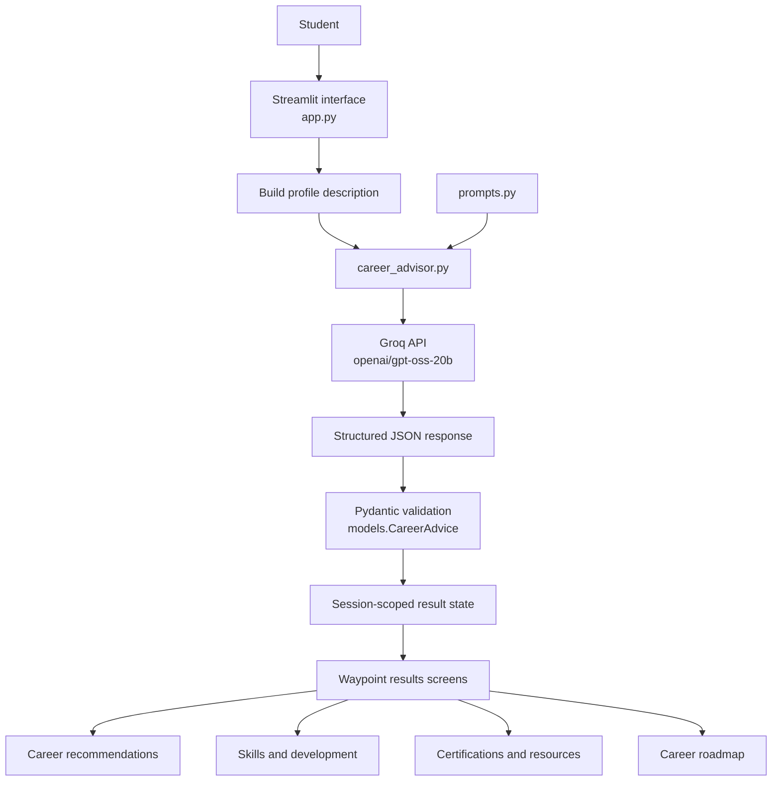
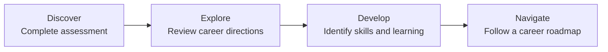
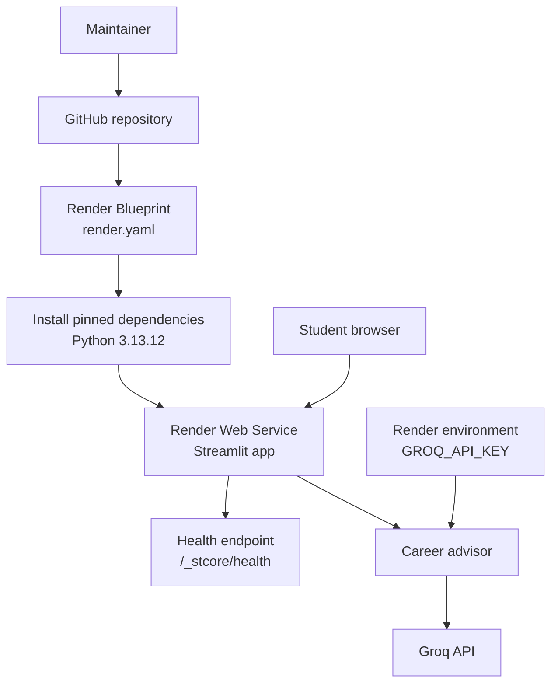
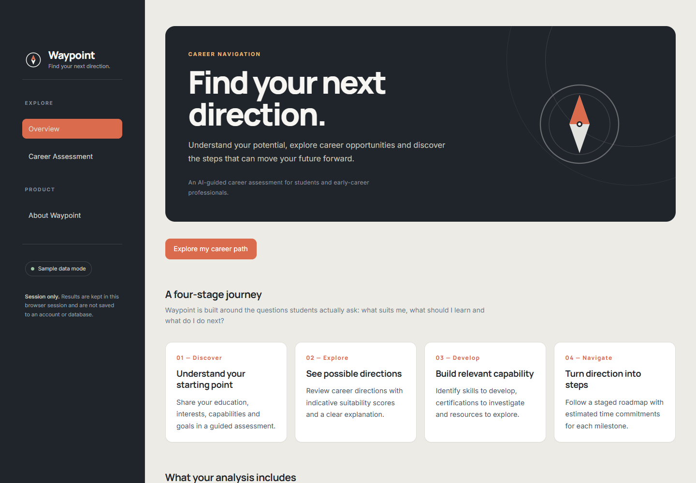
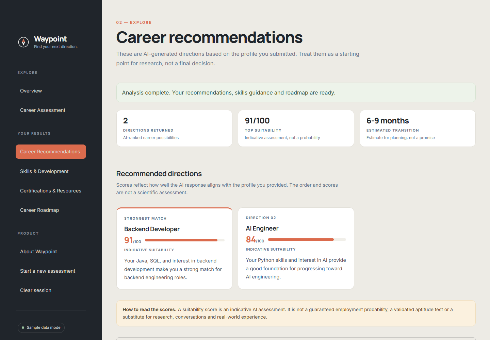
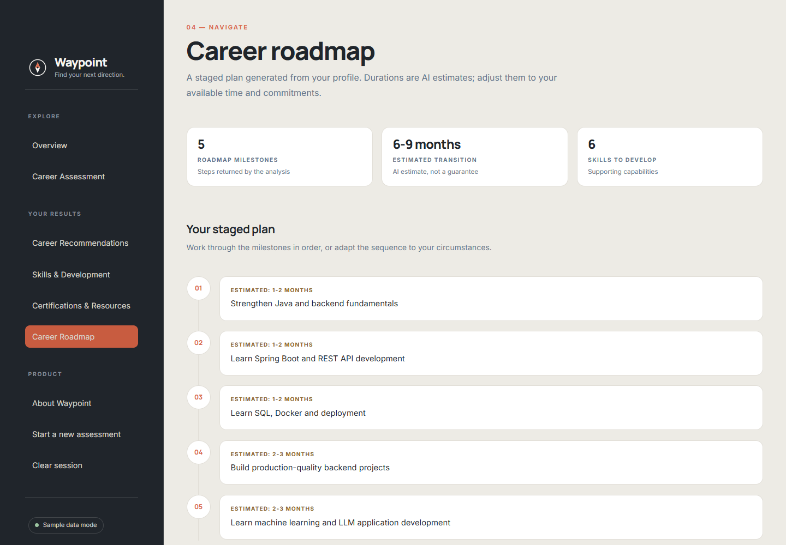

<div align="center">
  <a href="https://waypoint-career-navigation.onrender.com" aria-label="Open Waypoint website">
    
  </a>

  <h1>Waypoint</h1>
  <p><strong>Find your next direction.</strong></p>
  <p>Career navigation</p>

  <p>
    <a href="https://waypoint-career-navigation.onrender.com"><strong>Website</strong></a>
    &nbsp;·&nbsp;
    <a href="https://github.com/JayeshJadhav28/waypoint-career-navigation">Source code</a>
    &nbsp;·&nbsp;
    <a href="https://github.com/JayeshJadhav28/waypoint-career-navigation/issues">Report an issue</a>
  </p>
</div>

<p align="center">
  
  
  
  
  
  
</p>

---

## Overview

Waypoint is an AI-powered career navigation platform for students, recent graduates and early-career professionals. It turns a guided career assessment into structured guidance: career directions with indicative suitability scores, skills to develop, certifications and learning resources to investigate, and a staged career roadmap.

Built with Python, Streamlit, the Groq API and Pydantic, Waypoint keeps the existing career-advisor engine while presenting its output through a cohesive, responsive product experience.

## What Waypoint does

Waypoint organizes career exploration into four stages:

1. **Discover** — complete a guided assessment covering your education, interests, current capabilities and goals.
2. **Explore** — your submitted profile is sent through the existing career-advisor prompt to the Groq API.
3. **Develop** — review suggested skills, certifications and learning resources returned by the model.
4. **Navigate** — use the generated roadmap and its estimated durations as a starting point for planning.

## Features

- Guided, section-based career assessment covering profile, interests, capabilities and goals.
- AI analysis through the Groq API using the configured `openai/gpt-oss-20b` model.
- Structured response validation with Pydantic.
- Career recommendations with indicative suitability scores and explanations.
- Skills to develop, shown alongside the capabilities reported in the assessment.
- Certification and learning-resource recommendations.
- Numbered career roadmap with AI-estimated durations.
- Session-based results that remain available while navigating during the current session.
- Start-a-new-assessment and clear-session actions.
- User-facing error handling for missing API configuration and invalid responses.
- Mock-data mode for interface development and automated tests.

## How it works

### Application architecture



### Student journey



### Deployment architecture



The application does not use a database. Assessment results are held in the active Streamlit session and are not saved as permanent user records.

## AI recommendations and responsible use

The configured model is `openai/gpt-oss-20b`, accessed through the Groq API. The assessment is converted into a profile description, passed to the existing career-advisor prompt, and validated against the `models.CareerAdvice` Pydantic model before the results are displayed.

**Suitability scores are indicative AI assessments**, not employment probabilities, scientifically validated aptitude scores or guarantees of career success. Results depend on the accuracy and completeness of the submitted profile. Use them as a starting point for further research and discussion with people working in the relevant fields.

- **Reported capabilities** reflect what the student entered. Waypoint does not independently verify or score them.
- **Skills to develop** are suggestions returned by the AI; the application does not measure proficiency.
- **Certifications and learning resources** are generated recommendations. The current response schema does not provide provider URLs, so Waypoint does not invent links, validity periods or endorsements. Verify details with the official provider.
- **Roadmap durations** are AI estimates, not guaranteed completion periods.
- AI output may be inaccurate or outdated. Independently verify important career, course and certification decisions.

## Technology stack

| Layer | Technology |
| --- | --- |
| Language | Python 3.13.12 |
| Web interface | Streamlit 1.61.1 |
| AI provider | Groq API |
| Configured model | `openai/gpt-oss-20b` |
| Response validation | Pydantic 2.13.4 |
| Configuration | `python-dotenv`, environment variables, Streamlit secrets |
| CLI | Rich |
| Hosting | Render Blueprint |
| Browser / UI testing | Playwright and Streamlit AppTest (development and QA) |

Runtime dependencies are pinned in `requirements.txt`.

## Project structure

```text
waypoint-career-navigation/
├── app.py                     # Waypoint Streamlit application and navigation
├── ui_theme.py                # Design tokens, shared UI components and CSS
├── career_advisor.py          # Groq request and response handling
├── prompts.py                 # Career-advisor prompt definitions
├── models.py                  # Pydantic response models
├── mock_data.py               # Sample response for mock mode
├── main.py                    # Original Rich console CLI
├── requirements.txt           # Pinned Python dependencies
├── render.yaml                # Render Blueprint configuration
├── .python-version             # Python 3.13.12
├── .streamlit/
│   └── config.toml             # Streamlit theme and server configuration
├── assets/
│   ├── waypoint-logo.svg
│   ├── waypoint-mark.svg
│   ├── favicon.svg
│   └── favicon.png
├── tests/
│   └── test_app.py             # Streamlit AppTest suite
├── screenshots/                # Waypoint desktop, tablet and mobile captures
└── .github/
    └── workflows/
        └── keep-alive.yml      # Scheduled Render health check
```

## Interface previews

<p align="center">
  
</p>
<p align="center"><em>Overview</em></p>

<p align="center">
  
</p>
<p align="center"><em>Career recommendations</em></p>

<p align="center">
  
</p>
<p align="center"><em>Career roadmap</em></p>

Additional desktop, tablet and mobile screenshots are available in `screenshots/`.

## Run locally

### 1. Requirements

- Python 3.13.12 (the repository pins this in `.python-version`).
- A Groq API key for real career assessments.

### 2. Create and activate a virtual environment

**Windows PowerShell**

```powershell
py -3.13 -m venv .venv
.\.venv\Scripts\Activate.ps1
```

**macOS / Linux**

```bash
python3.13 -m venv .venv
source .venv/bin/activate
```

### 3. Install dependencies

```bash
python -m pip install -r requirements.txt
```

### 4. Configure the Groq API key

Create a `.env` file in the project root:

```dotenv
GROQ_API_KEY=your_groq_api_key
```

Create or manage a key at [Groq Console](https://console.groq.com/keys). Keep `.env` private; it is listed in `.gitignore`. Never commit API keys or paste them into source files.

### 5. Start Waypoint

```bash
python -m streamlit run app.py
```

Open [http://localhost:8501](http://localhost:8501).

### Optional: mock-data mode

Mock mode lets you inspect the result screens without making a Groq API request.

**Windows PowerShell**

```powershell
$env:WAYPOINT_USE_MOCK_DATA = "true"
python -m streamlit run app.py
```

**macOS / Linux**

```bash
WAYPOINT_USE_MOCK_DATA=true python -m streamlit run app.py
```

The interface displays a sample-data indicator and uses the bundled response from `mock_data.py`. Set `WAYPOINT_USE_MOCK_DATA=false` to explicitly request the real AI path.

## Run tests

Install the test runner if it is not already available:

```bash
python -m pip install pytest
```

Run the Streamlit AppTest suite in mock mode:

**Windows PowerShell**

```powershell
$env:WAYPOINT_USE_MOCK_DATA = "true"
python -m pytest tests -q
```

**macOS / Linux**

```bash
WAYPOINT_USE_MOCK_DATA=true python -m pytest tests -q
```

The AppTest suite exercises the interface without calling the Groq API. Real API integration tests should be run separately and will consume API usage.

## Deploy on Render

The repository includes `render.yaml` for Render Blueprint deployment.

### Blueprint configuration

- **Service:** `waypoint-career-navigation`
- **Runtime:** Python
- **Python:** 3.13.12 (from `.python-version`)
- **Plan:** Free initially
- **Build command:** `pip install -r requirements.txt`
- **Start command:**

  ```bash
  python -m streamlit run app.py --server.address 0.0.0.0 --server.port $PORT --server.headless true --browser.gatherUsageStats false
  ```

- **Health check:** `/_stcore/health`

### Deployment steps

1. Push the repository to GitHub.
2. Sign in to [Render](https://dashboard.render.com/).
3. Choose **New → Blueprint** and connect this repository.
4. Render reads `render.yaml` and prepares the service.
5. Set `GROQ_API_KEY` in the Render environment settings when prompted. Do not add the key to `render.yaml` or GitHub.
6. Set `WAYPOINT_USE_MOCK_DATA` to `false` in the Render environment to explicitly use the real AI path.
7. Apply the Blueprint, wait for deployment, and inspect the service logs.
8. Visit the deployed URL, verify `/_stcore/health`, and complete one real career assessment.

### Free-plan behaviour

Render Free web services can spin down after a period without inbound traffic. The first visit after inactivity may take longer while the service starts. The Free instance also has limited CPU and memory; monitor logs and resource usage during real assessments. Upgrade only if observed performance or memory use requires it.

### Optional keep-alive workflow

`.github/workflows/keep-alive.yml` contains a scheduled GitHub Actions workflow that requests the Streamlit health endpoint. It targets the default hostname `https://waypoint-career-navigation.onrender.com`.

If Render assigns a different hostname, configure the repository variable below:

`RENDER_APP_URL=https://<your-render-service>.onrender.com`

Add it under **Settings → Secrets and variables → Actions → Variables**. The workflow can also be started manually from **Actions → Keep-alive → Run workflow**. GitHub scheduled workflows are best-effort and may run late; the keep-alive workflow does not guarantee zero cold starts.

## Security and privacy

- The Groq API key is read from the environment or Streamlit secrets; it is not hard-coded.
- `.env`, `.venv/`, `.streamlit/secrets.toml` and Python cache files are excluded through `.gitignore`.
- Assessment results are session-scoped. There is no account system, database, permanent history or cross-device synchronisation.
- Submitted profile information is sent to the Groq API to generate recommendations.
- Do not enter passwords, financial details or unnecessary sensitive personal information.

## Current limitations

- No authentication, database, saved history or cross-device sync.
- No multi-turn career chat; each analysis is based on one submitted assessment.
- No resume upload, live job-market integration, salary prediction or interview preparation.
- Career scores are indicative AI-generated assessments, not validated aptitude measurements or employment probabilities.
- Course and certification details may be incomplete or outdated and must be independently verified.
- The current response schema does not provide provider URLs or skill-proficiency scores.

## Attribution

Waypoint began as an existing AI career-advisor codebase. The redesign preserves the original backend, prompts, response models and source attribution. The original project was titled **AI Career Advisor**, created by Muskan, and built with Python, Groq, Pydantic and Streamlit. Waypoint is an independent rebrand and is not affiliated with or endorsed by Groq, Render, any employer, certification provider or educational institution.

## License

A separate `LICENSE` file is not currently present in this repository. The previous project README referred to an MIT license, but confirm the original license and redistribution permissions with the original author before reusing or redistributing the code. Do not treat this README as a substitute for a license grant.
